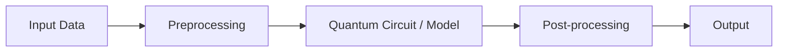

<div align="center">

# Hacktrioz

**VTU-QFF-HC-0019** &nbsp;|&nbsp; Tier: **Both**

</div>

---

<div align="center">

| | |
| :--- | :--- |
| **Team** | Hacktrioz |
| **Team ID** | VTU-QFF-HC-0019 |
| **Tier** | Both |
| **Repository** | [vtu-hc-hacktrioz](https://github.com/vtu-qiskit-fall-fest-2026/vtu-hc-hacktrioz.git) |
| **Organisation** | [vtu-qiskit-fall-fest-2026](https://github.com/vtu-qiskit-fall-fest-2026) |
| **Event** | VTU-QFF Hackathon — VTU-Qiskit Fall Fest 2026 |

</div>

---

## 📌 Table of Contents

- [Team Members](#-team-members-github-ids)
- [Problem Statement](#-problem-statement)
- [Proposed Solution](#-proposed-solution)
- [Approach & Architecture](#-approach--architecture)
- [Tech Stack](#-tech-stack)
- [Project Structure](#-project-structure)
- [How to Run](#-how-to-run)
- [How to Push Code](#-how-to-push-code)
- [Submission Checklist](#-submission-checklist)
- [Resources](#-resources)
- [License](#-license)

---

## 👥 Team Members (GitHub IDs)

> Members are added to this repository as **collaborators** and must accept the
> GitHub invitation before they can push. Add your GitHub username below.

| # | Name | GitHub Username | Role |
| :-- | :--- | :--- | :--- |
| 1 | _Spoorti R Batakurki_ | _SPOORTI-B777_ | _Team Lead_ |
| 2 | _Tanuja S Pujera_ | _Tanu-2008_ | _Developer_ |
| 3 | _Shweta Baliwad _ | _ShwetaDB-code_ | _Developer_ |

<!--
Optional: add a plain list instead of the table above.
- @username1
- @username2
-->

---

## ❓ Problem Statement

<!--
State the problem you are solving. Be specific: what is broken or missing,
who experiences it, and why does it matter. Link to the official problem
statement from the brief if one applies.
-->

**Problem:** _Over irrigation, or under irrigation is a havoc to the soil and also the underwater table. This is the same incase of fertilizers too._

**Why it matters:** _arm fields are not uniform. Different zones can have different soil moisture, nutrient availability and irrigation needs. Treating an entire field identically can waste water or fertilizer, while excess fertilizer can contribute to environmental pollution,especially underground water table and greenhouse-gas emissionn._

**Track / Category:** _Online · Track 6 · <domain>_

---

## 💡 Proposed Solution

<!--
Describe your solution. Keep it concrete: the core idea, the user flow, and
the quantum/ML technique you are applying.
-->

**Solution:** _Ia hybrid quantum-classical optimization prototype for sustainable agriculture,to explore irrigation-allocation decisions._

**Key idea:** _QSoil Guardian converts irrigation allocation into a binary optimization problem and uses a hybrid quantum-classical Quantum Approximate Optimization Algorithm workflow to explore candidate solutions, then benchmarks them against an exact classical solution to evaluate how effectively the approach solves the problem i.e., Soil Guardian uses quantum optimization to explore how to distribute limited irrigation resources among different soil zones according to their needs and priorities._

**Why this works:** _1. The farming decision can be expressed mathematically.
Each zone's selection is a yes-or-no decision. That makes it possible to define a cost function that rewards higher-priority selections and penalizes exceeding the resource budget.

2. Quantum Approximate Optimization Algorithm provides a structured way to search for solutions.
The cost and mixer operations transform the quantum state so that measurements can produce different candidate bitstrings. The circuit's parameters affect which candidates are more likely to appear. A classical optimizer adjusts those parameters to seek a lower expected cost.

3. The classical baseline tells us whether the result is good.
With only four zones, we can enumerate all possible allocations and find the exact optimum. That gives us a reliable reference against which to evaluate Quantum Approximate Optimization Algorithm.._

---

## 🧩 Approach & Architecture

<!--
Walk through how it works. A simple pipeline diagram in text or Mermaid is ideal.
-->



1. **Input** — _
. Soil-zone identifiers
A priority or benefit score for each zone
The irrigation allocation budget
QAOA circuit parameters to be optimized

FORMAT- Python data structures, primarily NumPy arrays and numerical values._
2. **Preprocessing** — _The input data is converted into a mathematical optimization problem.
- Assign each zone a binary decision variable: \(x_i \in \{0,1\}\).
- Encode 1 as selected and 0 as not selected.
- Convert the priority scores and allocation constraint into a cost function.
- Express the objective in a form that can be represented by a quantum cost Hamiltonian.
The project uses a penalty term to discourage selecting more zones than the budget permits_
3. **Quantum core** — _Its parameterized circuit contains:
- Hadamard gates (H): Initialize a superposition of possible binary assignments.
- Cost operations (RZ and RZZ): Encode the optimization objective into quantum phase changes.
- Mixer operations (RX): Help explore different candidate assignments.
- Parameterized layers: Control how the cost and mixer operations are combined.
-
- The core algorithm is QAOA (Quantum Approximate Optimization Algorithm)._
4. **Post-processing** — _Measure the qubits to obtain binary bitstrings.
Decode the bitstrings into soil-zone selections.
Evaluate each candidate using the original objective and budget constraint.
Identify a promising allocation from the sampled results.
Compare the result with an exact classical solution._

5. **Output** — _The program produces a candidate irrigation-allocation plan showing:
- Which soil zones are selected
- The objective score of the candidate
- Whether it satisfies the allocation constraint
- The comparison with the exact classical baseline_

---

## 🛠️ Tech Stack

| Layer | Technology |
| :--- | :--- |
| Language | Python 3.11+ |
| Quantum SDK | Qiskit `>=1.0`, Qiskit Aer, Qiskit Runtime |
| Optimisation | Qiskit Optimization / COBYLA / SPSA |
| Simulation | AerSimulator (statevector / noisemodel) |
| Environment | JupyterLab / VS Code, `venv` |
| Version control | Git + GitHub |

---

## 📁 Project Structure

```text
vtu-hc-hacktrioz/
├── README.md              # This file
├── requirements.txt       # Python dependencies
├── pyproject.toml         # Project metadata (optional)
├── .gitignore
├── notebooks/             # Jupyter notebooks for experiments
│   └── exploration.ipynb
├── src/
│   ├── __init__.py
│   ├── circuit.py         # Quantum circuit construction
│   ├── optimizer.py       # Optimization loop
│   └── main.py            # Entry point
├── data/                  # Datasets (use Git LFS for large files)
├── tests/                 # Unit tests
│   └── test_circuit.py
└── docs/                  # Notes, diagrams, reports
```

---

## 🚀 How to Run

### Prerequisites

- Python 3.11 or newer
- [Git](https://git-scm.com/downloads)
- A GitHub account (you need collaborator access to this repo)

### 1. Clone the repository

```bash
git clone https://github.com/vtu-qiskit-fall-fest-2026/vtu-hc-hacktrioz.git
cd vtu-hc-hacktrioz
```

### 2. Create a virtual environment

```bash
python3 -m venv .venv
source .venv/bin/activate        # Linux / macOS
# .venv\Scripts\activate         # Windows (PowerShell)
```

### 3. Install dependencies

```bash
pip install --upgrade pip
pip install -r requirements.txt
```

### 4. Run

```bash
python -m src.main
```

Or launch the notebook workflow:

```bash
jupyter lab
```

### 5. Run the tests

```bash
pytest -q
```

---

## 🔁 How to Push Code

> Full walkthrough: **[Git & Collaboration Handbook](../vtu-hc-guide-git-and-collaboration)** — collaboration
> workflow, branches, pull requests, reviews and conflict resolution.

### Configure Git (first time only)

```bash
git config --global user.name  "Your Name"
git config --global user.email "you@example.com"
```

### Everyday workflow

```bash
# 1. Get the latest changes
git checkout main
git pull origin main

# 2. Create a branch for your work
git checkout -b feature/my-task

# 3. Commit your work
git add .
git commit -m "feat: add variational circuit for the search problem"

# 4. Push the branch
git push -u origin feature/my-task

# 5. Open a Pull Request on GitHub and request a review
#    https://github.com/vtu-qiskit-fall-fest-2026/vtu-hc-hacktrioz/compare/main...feature/my-task

# 6. After approval, merge into main
git checkout main
git pull origin main
git branch -d feature/my-task
```

### Commit message convention

| Prefix | Meaning |
| :--- | :--- |
| `feat:` | New feature |
| `fix:` | Bug fix |
| `docs:` | Documentation only |
| `test:` | Adding or fixing tests |
| `refactor:` | Code restructure, no behaviour change |
| `chore:` | Build/config/dependency changes |

### Useful commands

```bash
git status              # what changed
git log --oneline -10   # recent commits
git diff                # review changes before committing
git stash               # shelve changes temporarily
git pull --rebase       # update your branch on top of main
```

### Collaborating on the same repo

- **Never push directly to `main`** — open a Pull Request.
- **Pull before you push** to avoid rejected commits.
- **Commit often** with clear messages.
- **Resolve conflicts** locally: `git pull --rebase`, fix the files, then `git add` + `git rebase --continue`.
- **Ask for a review** before merging — a second pair of eyes catches bugs fast.

---

## ✅ Submission Checklist

- [ ] Repository created and **public**
- [ ] All team members added as **collaborators** and invitations accepted
- [ ] `README.md` updated with project details, problem statement and solution
- [ ] Team members listed under [Team Members](#-team-members-github-ids)
- [ ] `requirements.txt` committed and project runs from a clean clone
- [ ] Code pushed to `main` and the latest `main` builds successfully
- [ ] Notebooks committed with **cleared outputs** (or use `nbstrip`)
- [ ] `README` includes a demo screenshot / video link
- [ ] Short project summary submitted on the hackathon portal

---

## 📚 Resources

| Resource | Link |
| :--- | :--- |
| 🔁 Git & collaboration handbook | [Git & Collaboration Handbook](../vtu-hc-guide-git-and-collaboration) |
| ❓ Problem statements, solutions & terms | [Problem Statements, Solutions & Terms](../vtu-hc-guide-problem-and-solution) |
| 📄 README writing guide | [README Guide & Template](../vtu-hc-guide-readme-template) |
| ⚛️ Qiskit documentation | https://docs.quantum.ibm.com/ |
| ⚛️ Qiskit Runtime & primitives | https://quantum.cloud.ibm.com/docs/ |
| 🧪 Qiskit Aer simulator | https://docs.quantum.ibm.com/guides/simulator |
| 💻 IBM Quantum Platform | https://quantum.cloud.ibm.com/ |
| 🎓 Qiskit textbook | https://qiskit.qotlabs.org/learning/ |
| 📋 GitHub Docs | https://docs.github.com/ |

---

## 📄 License

Released under the [MIT License](LICENSE). See `LICENSE` for details.

---

<div align="center">

**Hacktrioz** · Team ID `VTU-QFF-HC-0019` · Tier `Both`
· Built with ⚛️ Qiskit for the VTU-QFF Hackathon

[⬆ Back to Top](#hacktrioz)

</div>
